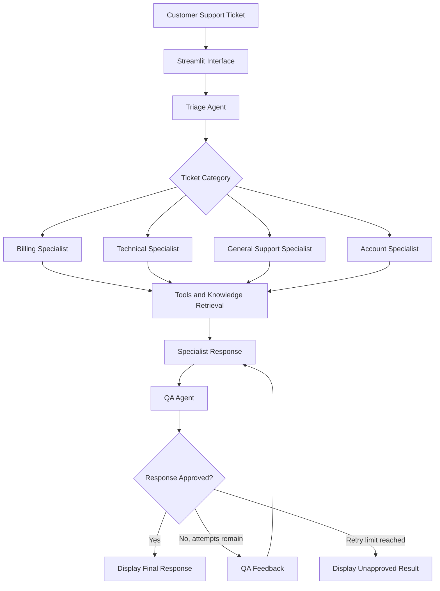

# 🎫 SupportCrew AI
### A Multi-Agent Customer Support & Ticket Resolution System

**SupportCrew AI** is an AI-powered customer support system that uses specialized agents to classify incoming tickets, route them to the appropriate support specialist, retrieve relevant knowledge-base information, use customer-support tools, and evaluate responses through a quality-assurance feedback loop.

Built with **CrewAI, Python, Ollama, ChromaDB, Sentence Transformers, and Streamlit**, the project explores how multi-agent orchestration and retrieval-augmented generation (RAG) can work together to produce more structured and context-aware support responses.

<p align="center">
  
  
  
  
  
</p>

---

## 📌 Overview

Traditional support workflows often require tickets to be manually classified, assigned, investigated, and reviewed. SupportCrew AI demonstrates how these stages can be organized into a multi-agent workflow.

Instead of relying on a single general-purpose prompt, the system assigns distinct responsibilities to specialized agents and uses tools, retrieved documentation, and a QA feedback loop to support the resolution process.

### Key capabilities

- **Intelligent triage:** Classifies support tickets and identifies their priority and issue summary.
- **Specialist routing:** Directs tickets to Billing, Technical, General Support, or Account specialists.
- **Tool-assisted investigation:** Provides tools for looking up customer information and order status using sample records.
- **Retrieval-Augmented Generation (RAG):** Retrieves relevant support documentation using semantic search.
- **Quality assurance:** Reviews specialist responses and provides feedback when revisions are needed.
- **Bounded retry loop:** Allows a specialist to revise a response based on QA feedback, with a configurable attempt limit.
- **Interactive web interface:** Accepts tickets and displays the resulting analysis through Streamlit.
- **Local LLM inference:** Uses Ollama to run the configured language model locally.

## 🏗️ System Architecture



*Architecture overview: the specialist uses the available tools and knowledge sources as appropriate for the ticket. The exact retrieval and tool usage depend on the workflow and agent configuration.*

## 🔄 How It Works

### 1. Ticket intake and triage

A user submits a support issue through the Streamlit interface or the command-line workflow.

The triage agent identifies the ticket's category, priority, and main issue, providing structured information for the next stage.

### 2. Specialist selection

The ticket is routed to one of four specialist agents:

| Specialist | Responsibility |
|---|---|
| Billing Agent | Investigates billing-related support requests |
| Technical Agent | Handles technical problems and troubleshooting |
| General Support Agent | Handles general customer questions |
| Account Agent | Handles account and access-related requests |

### 3. Tool-assisted investigation

The system includes tools for retrieving sample customer details and order status. These tools allow agents to use available application data rather than relying exclusively on generated text.

The current records are demonstration data, not a live connection to a production CRM or order-management platform.

### 4. Knowledge retrieval with RAG

For technical support, the system can retrieve relevant passages from its local support knowledge base.

The retrieval pipeline uses Sentence Transformers to create semantic embeddings and ChromaDB to store and search document chunks.

Retrieved content can provide the specialist with relevant troubleshooting context and can also be supplied to the QA stage for evaluation.

### 5. Quality assurance and revision

After a specialist drafts a response, the QA agent evaluates it against the configured review criteria.

- If approved, the response is returned to the interface.
- If rejected, QA feedback is passed back for revision.
- If the configured attempt limit is reached, the final result is returned with its approval status clearly indicated.

The retry limit is controlled by `MAX_RETRIES` in the application workflow. A value of `2` permits up to three total response attempts: the initial attempt and two retries.

**Important:** QA approval represents the agent's evaluation against configured criteria; it does not guarantee factual correctness. Reliable production use would require stronger grounding checks and systematic evaluation.

---

## 🧰 Technology Stack

| Technology | Purpose |
|---|---|
| Python | Application logic and workflow integration |
| CrewAI | Agent definitions, tasks, and orchestration |
| Ollama | Local language-model inference |
| Qwen2 7B | Configured local language model (`qwen2:7b`) |
| Streamlit | Interactive browser-based interface |
| ChromaDB | Vector storage and semantic retrieval |
| Sentence Transformers | Text embeddings for knowledge retrieval |
| Pydantic | Structured data validation where configured |
| uv | Python dependency and environment management |
| Git and GitHub | Version control and source-code hosting |

## 📂 Project Structure

The following outlines the main application modules.

```text
supportcrew-ai/
├── app.py
├── main.py
├── pyproject.toml
├── README.md
├── knowledge_base/
│   └── support_faq.txt
├── chroma_db/
├── src/
│   └── supportcrew_ai/
│       ├── __init__.py
│       ├── agents.py
│       ├── config.py
│       ├── main.py
│       ├── models.py
│       ├── router.py
│       ├── tasks.py
│       ├── tickets.py
│       ├── tools.py
│       └── rag/
│           ├── knowledge_base.py
│           └── tool.py
└── tests/
    ├── test_order_tool.py
    ├── test_customer_tool.py
    ├── test_billing_agent.py
    ├── test_rag.py
    └── test_rag_agent.py
```

*The tree highlights the main files and may omit local environment files, generated artifacts, or other repository contents.*

### Module responsibilities

| Module | Responsibility |
|---|---|
| `agents.py` | Defines triage, specialist, and QA agents |
| `tasks.py` | Defines tasks for triage, specialist responses, and QA |
| `models.py` | Defines structured application data models |
| `router.py` | Contains ticket-routing logic |
| `tools.py` | Implements customer and order lookup tools |
| `tickets.py` | Provides predefined demonstration tickets |
| `config.py` | Holds application and model configuration |
| `rag/knowledge_base.py` | Initializes and searches the vector knowledge base |
| `rag/tool.py` | Exposes knowledge retrieval to the agent workflow |
| `src/supportcrew_ai/main.py` | Runs the ticket-processing workflow and CLI entry point |
| `app.py` | Provides the Streamlit user interface |
| `tests/` | Contains tests for tools, agents, and RAG components |

---

## 🚀 Getting Started

Follow these instructions to run SupportCrew AI locally.

### Prerequisites

Install the following before starting:

- Python 3.11 or a compatible version supported by the project's dependencies
- [uv](https://docs.astral.sh/uv/)
- [Ollama](https://ollama.com/)
- Git

The project currently uses the `qwen2:7b` model through Ollama.

### 1. Clone the repository

```bash
git clone https://github.com/Mahee0117/Ticket_resolver_crewai.git
cd Ticket_resolver_crewai
```

### 2. Install dependencies

```bash
uv sync
```

This creates or updates the project's virtual environment and installs the dependencies declared in `pyproject.toml` and the lockfile, when present.

If Streamlit is not declared in your project dependencies yet, add it with:

```bash
uv add streamlit
```

### 3. Download the language model

```bash
ollama pull qwen2:7b
```

Ensure Ollama is running and the model is available:

```bash
ollama list
```

On macOS, Ollama can generally be started through its desktop application. If your installation uses the command-line server, start it in a separate terminal:

```bash
ollama serve
```

If the server is already running, do not start a second instance.

### 4. Run the command-line workflow

From the repository root:

```bash
uv run python -m supportcrew_ai.main
```

This runs the predefined-ticket workflow and prints the processing results in the terminal.

### 5. Run the Streamlit interface

From the repository root:

```bash
uv run streamlit run app.py
```

Open the local address displayed in the terminal, typically:

```text
http://localhost:8501
```

Enter a ticket or choose an example, then select **Analyze Ticket** to run the workflow and view the response and QA result.

### 6. Stop the application

Press `Ctrl + C` in the terminal running the application.

---

## 🧪 Testing

The repository includes tests for customer lookup, order lookup, specialist-agent behavior, and knowledge retrieval.

Run the available test suite with:

```bash
uv run pytest
```

If pytest is not installed in the project environment, add it as a development dependency:

```bash
uv add --dev pytest
```

Run individual tests when debugging:

```bash
uv run pytest tests/test_customer_tool.py
uv run pytest tests/test_order_tool.py
uv run pytest tests/test_rag.py
```

These commands assume the listed test files and pytest-compatible test functions are present in the checked-out repository. A passing test suite validates only the behavior covered by those tests.

## 🔐 Configuration and Security

- Keep API keys, credentials, and private configuration out of source control.
- Use environment variables or the hosting platform's secrets manager for sensitive settings.
- The current demonstration tools use sample customer and order data.
- The local Ollama model must be available wherever the backend workflow executes.
- Do not expose real customer information in public demonstrations or logs.
- A cloud deployment requires a model endpoint accessible from the hosting environment; a reference to `localhost` on a developer's machine will not reach that machine from a remote server.

## ⚠️ Current Scope and Limitations

SupportCrew AI is a learning and demonstration project focused on multi-agent support workflows.

- Customer and order lookups use demonstration records.
- The knowledge base is local and depends on the supplied support documentation.
- Model-generated responses can contain unsupported claims or incorrect advice.
- QA approval is not a guarantee of factual accuracy.
- The application does not currently represent a complete production customer-support platform with authentication, persistent ticket management, service-level monitoring, or live CRM integration.
- Local execution is supported by the current Ollama configuration. Public deployment requires a cloud-accessible model configuration and deployment-specific setup.

## 🛣️ Future Improvements

Potential next steps include:

- Stronger evidence-grounded response validation
- More comprehensive automated tests and evaluation datasets
- Persistent ticket history and response tracking
- Better visibility into agent execution, tool calls, and QA revisions
- Cloud deployment with a securely configured hosted language model
- Integration with real customer-support APIs and knowledge sources

These are potential improvements, not claims about features already implemented.

## 🎯 Project Goals

This project demonstrates practical experience with:

- Designing role-based multi-agent workflows
- Structuring agent tasks and routing logic
- Integrating tools with language-model agents
- Building a local RAG pipeline with vector search
- Implementing bounded feedback-driven response revision
- Connecting an AI backend to a Streamlit application
- Testing individual components and troubleshooting LLM-based systems

## 👨‍💻 Author

**Mahesh M. S. K.**

Computer Science Engineering · AI Engineering · Multi-Agent Systems · DevOps

- GitHub: [@Mahee0117](https://github.com/Mahee0117)

---

<p align="center">
  <sub>Built to explore reliable, tool-assisted and knowledge-grounded AI support workflows.</sub>
</p>
