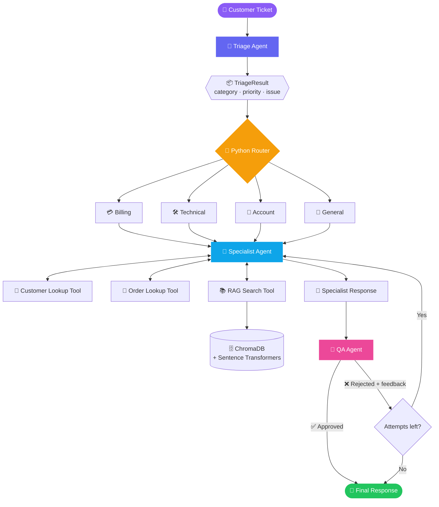
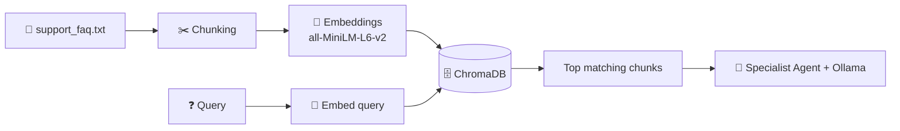
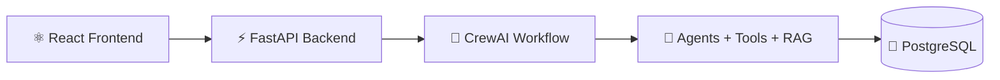

<div align="center">


<a href="https://github.com/Mahee0117/Ticket_resolver_crewai">
  
</a>

<br/>


**[Overview](#-overview)** · **[What's new in v3](#-whats-new-in-v3)** · **[How it works](#-how-it-works)** · **[Quick start](#-quick-start)** · **[Limitations](#-known-limitations)** · **[Roadmap](#-roadmap)**

</div>

---

## 📌 Overview

**SupportCrew AI** is a local, multi-agent customer support prototype built with **[CrewAI](https://www.crewai.com/)**.

A ticket comes in. A **Triage Agent** classifies it and sets its priority, then routes it to the right **specialist agent**. Specialists can **call Python tools** to look up customer and order data and **search a support knowledge base (RAG)** before writing a response. A **QA Agent** then reviews the draft and, if needed, sends it back with feedback for a bounded number of retries.

## 🎯 Problem statement

Support teams deal with:

- Manual, repetitive ticket triage
- Inconsistent answers to similar questions
- Responses that aren't backed by real data or documentation

SupportCrew AI explores how specialised agents, tool lookups, document retrieval and an automated reviewer can address those problems. It's a prototype, so the [limitations](#-known-limitations) are spelled out honestly below.

---

## 🆕 What's new in v3

<table>
<tr>
<td width="50%" valign="top">

### 🧰 Tool-enabled agents
An LLM shouldn't invent live customer or order details, so specialists can call Python tools instead:

| Tool | Purpose |
|---|---|
| `get_customer(customer_id)` | Look up a customer record |
| `get_order_status(order_id)` | Get order status and delivery info |

> ℹ️ The tools read **sample / mock records**. This is not a live order-management integration.

</td>
<td width="50%" valign="top">

### 📚 Local RAG pipeline
Agents need documented information, not just pretrained knowledge. A local retrieval pipeline lets specialists search a support knowledge document and use the results in their answer.

- Document chunking
- `all-MiniLM-L6-v2` embeddings
- Persistent **ChromaDB** vector store
- Exposed to agents as a CrewAI tool: `search_support_knowledge`

</td>
</tr>
</table>

<details>
<summary><b>V1 → V2 → V3 at a glance</b></summary>

<br/>

| Version | Focus | Highlights |
|:---:|---|---|
| **v1** | Triage and routing | Triage Agent, 4 categories, 4 priorities, specialist routing |
| **v2** | QA and retry | QA Agent, structured `QAResult`, bounded retries (max 3 attempts), local Ollama |
| **v3** | Tools and retrieval | Customer and order lookup tools, local RAG, tighter technical and QA instructions |

</details>

---

## 🧠 How it works



> 📐 This diagram shows the **intended structure** of the system. It is not proof that every path and failure mode has been tested.

<table>
<tr>
<td width="20%" align="center"><h3>1️⃣</h3><b>Ticket</b><br/><sub>A customer describes the problem</sub></td>
<td width="20%" align="center"><h3>2️⃣</h3><b>Triage</b><br/><sub>Category, priority and issue summary</sub></td>
<td width="20%" align="center"><h3>3️⃣</h3><b>Route</b><br/><sub>Plain Python logic picks one specialist</sub></td>
<td width="20%" align="center"><h3>4️⃣</h3><b>Look up</b><br/><sub>Call tools and search the knowledge base</sub></td>
<td width="20%" align="center"><h3>5️⃣</h3><b>QA</b><br/><sub>Approve, or retry with feedback</sub></td>
</tr>
</table>

### 🧰 Tool example

```text
Ticket: "Where is my order ORD101?"

Specialist → get_order_status("ORD101")
Tool       → Shipped · delivery date October 27, 2026
Response   → written using the tool result
```

An unknown ID such as `ORD999` is correctly reported as **not found** rather than invented.

### 📚 RAG pipeline



The sample knowledge document covers: **Password reset · PDF uploads · Order delivery · Account security**

### 🔁 QA retry loop

Rejected responses go back to the specialist together with the QA feedback. The loop is **bounded** (max 3 attempts, including the first) so it can never run forever.

### 📦 Structured outputs

```python
class TriageResult(BaseModel):
    category: str
    priority: str
    issue: str

class QAResult(BaseModel):
    approved: bool
    feedback: str
```

---

## 🦸 Meet the crew

| Agent | Role |
|:-:|---|
| 🔎 **Triage Agent** | Classifies tickets into `Billing` · `Account` · `Technical` · `General` and assigns `Low` · `Medium` · `High` · `Urgent` priority |
| 💳 **Billing Agent** | Payments, refunds, duplicate charges, subscriptions, billing problems |
| 🛠️ **Technical Agent** | Crashes, bugs, errors, technical failures, troubleshooting |
| 👤 **Account Agent** | Login problems, password issues, account access, profile problems, account security |
| 💬 **General Support Agent** | General questions, information requests, how-to questions |
| 🧪 **QA Agent** | Reviews each specialist response and returns a structured verdict |

---

## 🛠️ Tech stack

| Layer | Tools |
|---|---|
| 🐍 Language | Python 3.11 |
| 🤝 Agent framework | CrewAI |
| 🧠 LLM runtime and model | Ollama · `qwen2:7b` (local) |
| 🗄️ Vector store | ChromaDB (persistent, local) |
| 🧮 Embeddings | Sentence Transformers · `all-MiniLM-L6-v2` |
| ✅ Data validation | Pydantic |
| 📦 Packaging | uv |

---

## 📁 Project structure

```text
Ticket_resolver_crewai/
│
├── knowledge_base/
│   └── support_faq.txt          # sample support documentation
│
├── src/
│   └── supportcrew_ai/
│       ├── __init__.py
│       ├── main.py              # orchestration + QA retry loop
│       ├── config.py            # local Ollama LLM setup
│       ├── models.py            # TriageResult, QAResult
│       ├── agents.py            # all six agents
│       ├── tasks.py             # all tasks
│       ├── router.py            # category → specialist
│       ├── tickets.py           # sample tickets
│       ├── tools.py             # customer + order lookup (sample data)
│       └── rag/
│           ├── __init__.py
│           ├── knowledge_base.py  # load, chunk, embed, index, retrieve
│           └── tool.py            # CrewAI tool: search_support_knowledge
│
├── test_customer_tool.py
├── test_order_tool.py
├── test_billing_agent.py
├── test_rag.py
├── test_rag_agent.py
├── pyproject.toml
└── uv.lock
```

---

## 🚀 Quick start

**Prerequisites:** Python 3.11, [uv](https://docs.astral.sh/uv/) and [Ollama](https://ollama.com/)

**1. Clone the repository**

```bash
git clone https://github.com/Mahee0117/Ticket_resolver_crewai.git
cd Ticket_resolver_crewai
```

**2. Install dependencies**

```bash
uv sync
```

**3. Pull the local model**

```bash
ollama pull qwen2:7b
```

Make sure Ollama is running (it serves on `http://localhost:11434` by default).

**4. Run it**

```bash
uv run python -m supportcrew_ai.main
```

> ⏳ The first RAG run may take longer because the embedding model has to be downloaded.
> ✅ No API keys are needed. Everything runs on your machine.

---

## 🧪 Testing

These are the standalone scripts used to check each piece. Run them from the project root:

```bash
uv run python test_customer_tool.py   # customer lookup tool
uv run python test_order_tool.py      # order lookup tool
uv run python test_billing_agent.py   # billing agent calling the order tool
uv run python test_rag.py             # indexing + semantic retrieval
uv run python test_rag_agent.py       # technical agent calling the RAG tool
```

### What was verified

| Area | Result |
|---|---|
| Order lookup | `ORD101` returned **Shipped**, delivery October 27, 2026 |
| Unknown order | `ORD999` correctly reported as **not found** |
| Retrieval | Returned relevant sections for password reset, PDF upload failures, order delivery and unauthorized-transaction queries |
| Technical agent + RAG | The agent calls the RAG tool; in the full app, a technical ticket retrieved the **PDF Upload Errors** documentation |
| QA retry path | Implemented, but recent tickets passed on the first attempt, so a real reject → retry cycle is not yet demonstrated |

<!--
📸 Add a terminal screenshot or GIF of a real run here, for example:
<p align="center"></p>
-->

---

## ✅ Status: what's done and what isn't

| Capability | Status |
|---|:-:|
| Ticket classification and prioritisation | ✅ Implemented and exercised |
| Category-based specialist routing | ✅ Implemented and exercised |
| Structured triage and QA output (Pydantic) | ✅ Implemented |
| Bounded QA retries | ✅ Implemented (not yet triggered in a real run) |
| Customer and order lookup tools | ✅ Implemented, tested with sample data |
| RAG indexing and semantic retrieval | ✅ Implemented and tested |
| Technical agent using RAG | ✅ Confirmed in standalone and full runs |
| QA verifying claims against retrieved evidence | ❌ Not yet achieved |
| Persistent ticket database | ❌ Not implemented |
| API and user dashboard | ❌ Not implemented |
| Automated regression / evaluation suite | ❌ Not yet established |
| Production deployment | ❌ Not implemented |

---

## ⚠️ Known limitations

Please read these before judging the results.

- **Responses aren't guaranteed to be grounded.** Retrieval works, but the technical agent has still produced troubleshooting advice that the retrieved documentation doesn't support, even after stricter instructions. QA approved that response. Evidence-grounded enforcement is an open problem, not a solved one.
- **Retrieval ranking isn't perfect.** In testing, the unauthorized-access query didn't rank the Account Security section first.
- **Sample data only.** The customer and order tools use mock records, not live systems, and the knowledge base is a small sample document.
- **Small local model.** Qwen2 7B can be verbose and speculative.
- **No evaluation suite yet.** Behaviour is checked with manual test scripts.

This is a learning prototype. It is **not** hallucination-free and **not** production-ready.

---

## 🗺️ Roadmap

| Version | Milestone | Status |
|:---:|---|:---:|
| **v1.0** | Multi-agent triage and routing | ✅ **Done** |
| **v2.0** | QA Agent + feedback retry loop + local Ollama | ✅ **Done** |
| **v3.0** | Tools + local RAG knowledge base | ✅ **Done** |
| **v4.0** | CrewAI Flow + human escalation | 🗓️ Planned |
| **v5.0** | FastAPI + PostgreSQL + React | 🗓️ Planned |

<details>
<summary>🔧 <b>Next improvements</b> (before or alongside v4)</summary>

<br/>

- Enforce evidence-grounded answers, and make QA check claims against retrieved docs
- Evaluate and improve retrieval ranking
- Add an automated regression / evaluation suite
- Demonstrate a real reject → retry → approve cycle
- Keep specialist responses concise

</details>

<details>
<summary>🟣 <b>v4.0: CrewAI Flow &amp; Human Escalation</b> (planned)</summary>

<br/>

Move orchestration into a structured **CrewAI Flow**, and escalate to a human for:

- High-risk security issues
- Complex unresolved tickets
- Tickets that still fail QA after the retry limit

</details>

<details>
<summary>🚀 <b>v5.0: Production Application</b> (planned)</summary>

<br/>



</details>

> 🚧 Everything from v4.0 onward is a **plan, not a feature that exists today.**

---

## 📚 Learning journey

This project doubles as a hands-on way of learning CrewAI, built one layer at a time:

```text
Single Agent → Multiple Agents → Routing → Structured Outputs → QA + Feedback
      → Tools → RAG → Workflow Orchestration → Full Application
```

---

## 👨‍💻 Author

<div align="center">

**Mahesh M S K**
<br/>
<sub>Computer Science student · Agentic AI · Multi-Agent Systems · Generative AI · DevOps · Cloud · Full-Stack</sub>

<br/>

[](https://github.com/Mahee0117)
[](https://linkedin.com/in/msk-mahesh-98708829a)
[](https://portfolio-nu-sepia-sw11y787dc.vercel.app)

<br/>

**Current version: v3.0** · 🚧 Actively being developed

⭐ *If you find this project interesting, consider giving it a star!*


</div>